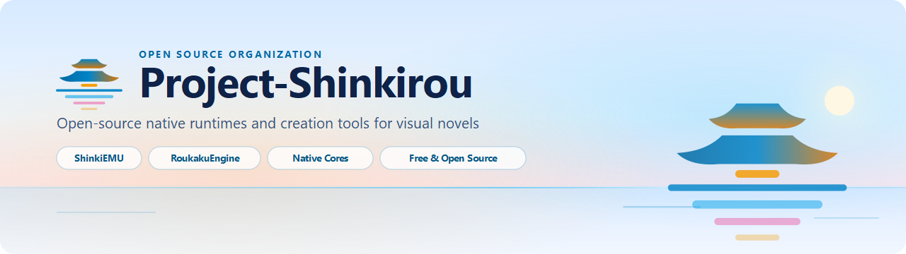

<picture>
  <source media="(prefers-color-scheme: dark)" srcset="assets/org-banner-dark.png">
  
</picture>

# Project-Shinkirou

**Open-source native runtimes and tools for visual novels.**
 
**让每一部视觉小说，在今天的设备上自由延续。**

[Official Portal / 官方门户](https://project-shinkirou.github.io/) · [Download ShinkiEMU / 下载](https://project-shinkirou.github.io/en/shinkiemu/#download) · [Compatibility / 兼容性](https://project-shinkirou.github.io/en/shinkiemu/compatibility/) · [Documentation / 文档](https://project-shinkirou.github.io/en/shinkiemu/docs/) · [Discussions / 社区讨论](https://github.com/Project-Shinkirou/ShinkiEMU/discussions)

---

## Our Projects / 核心项目

| Project | Role | Status | Links |
|---|---|---|---|
| **[ShinkiEMU](https://github.com/Project-Shinkirou/ShinkiEMU)** | Cross-platform visual novel library manager and 11 modular native engine cores across 10 engine families (Windows, Linux, macOS, Android, iOS, OpenHarmony) | **Active Beta** (`0.1.0-beta.8`) | [Portal](https://project-shinkirou.github.io/en/shinkiemu/) · [Releases](https://github.com/Project-Shinkirou/ShinkiEMU/releases) · [Docs](https://project-shinkirou.github.io/en/shinkiemu/docs/) |
| **[Project-Shinkirou.github.io](https://github.com/Project-Shinkirou/Project-Shinkirou.github.io)** | Official trilingual web portal (简体中文 / English / 日本語), live compatibility index, core catalog, Luau patch library, and documentation site | **Active** | [Website](https://project-shinkirou.github.io/) · [Status](https://project-shinkirou.github.io/en/status/) |
| **[RoukakuEngine](https://github.com/Project-Shinkirou/RoukakuEngine)** | Open-source native 2D visual novel engine, player, editor, and shared Rust runtime libraries powering ShinkiEMU | **Source Public** (feature dev paused) | [Portal](https://project-shinkirou.github.io/en/roukaku/) · [Docs](https://project-shinkirou.github.io/en/roukaku/docs/) |

## About Our Adapter Forks / 关于组织内的适配仓库

You will see several engine repositories forked under `Project-Shinkirou` (`rfvp`, `siglus_rs`, `art3m1s-core`, `sena-rs`, `ethornell-rs`, `ReMinori`, `kirikiroid2-web`, `impacto`, `renpy`). Each fork carries a thin **ShinkiEMU C ABI v3 adapter** on a dedicated integration branch while keeping upstream attribution, save formats, licenses, and corresponding-source bundles intact.

## Join the Community / 参与社区

- **Ask & share:** [ShinkiEMU GitHub Discussions](https://github.com/Project-Shinkirou/ShinkiEMU/discussions)
- **Contribute without coding:** Submit a [Game Compatibility Report](https://github.com/Project-Shinkirou/ShinkiEMU/issues/new?template=compatibility.yml), improve trilingual docs/translations, or share reviewed [Luau Patches](https://github.com/Project-Shinkirou/ShinkiEMU/issues/new?template=patch.yml).
- **Contribute code:** Start with [ShinkiEMU Contributing Guide](https://github.com/Project-Shinkirou/ShinkiEMU/blob/main/CONTRIBUTING.md).

> [!IMPORTANT]
> **100% Free & Open Source · No Donations Accepted**
> All Project-Shinkirou software is completely free and open source — download only from our [official portal](https://project-shinkirou.github.io/) or GitHub Releases. We do not accept financial donations; starring our repos, sharing real compatibility reports, and contributing PRs are the best ways to support us.
